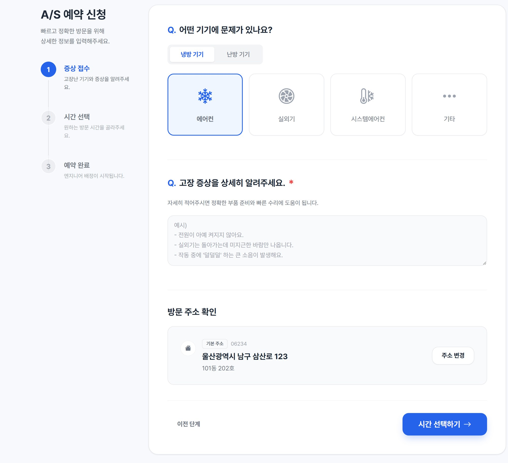
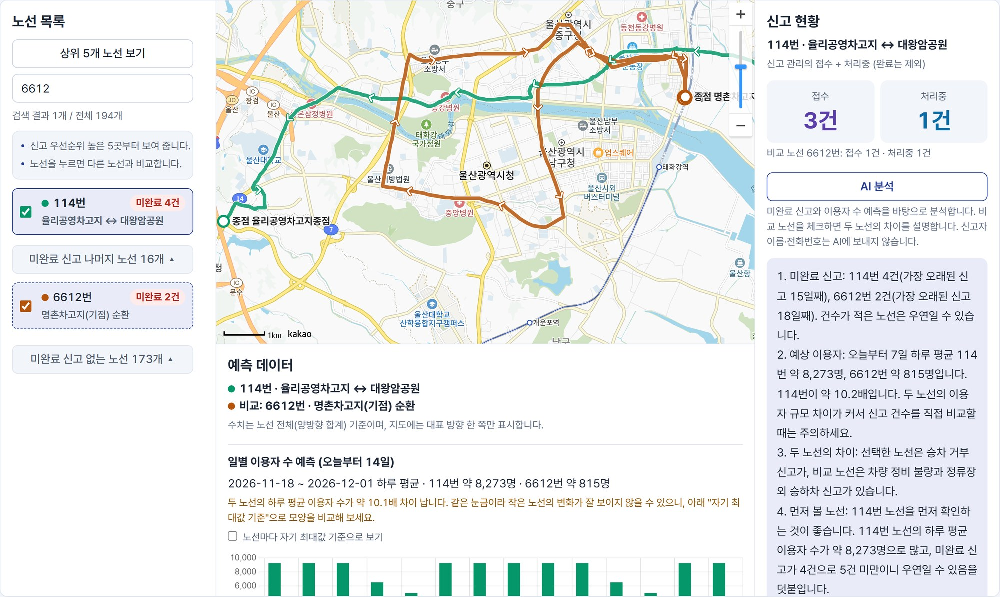
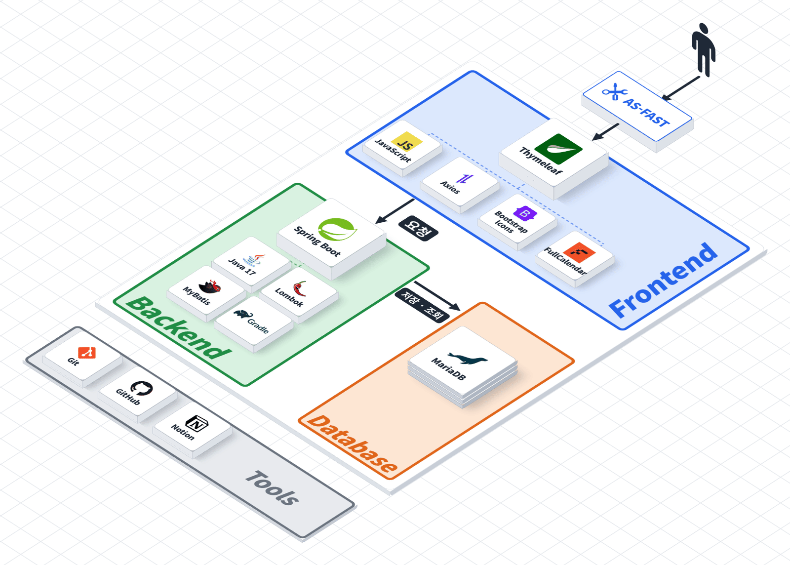

# 포트폴리오

그린AI캠퍼스 평생교육원 「공공데이터를 활용한 AI 풀스택 웹 개발」 과정에서 팀 COMMIT(3명)으로 진행한 프로젝트 3개입니다.

---

## 1차 · [AS-FAST · 냉난방 A/S 실시간 예약 서비스](https://github.com/rabo1226/project1)

2026.09.08 ~ 09.17 · 로그인, 예약 신청 폼

---

## 2차 · [도시가스 공급량 수요 예측 대시보드](https://github.com/rabo1226/project2)

2026.09.18 ~ 10.14 · 「지역 상세」 페이지, 도시가스 데이터 · [예측 서버(Python)](https://github.com/rabo1226/project2_python)

---

## 3차 · [울산 버스 이용자 수 예측 · 불편 신고](https://github.com/rabo1226/project3)

2026.10.19 ~ 11.12 · 관리자 「버스 이용수요」 페이지

---

## 기술 스택

