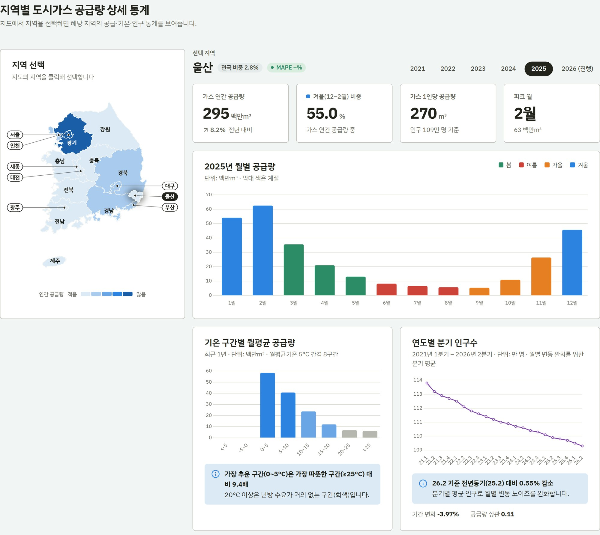

# 포트폴리오

그린AI캠퍼스 평생교육원 「공공데이터를 활용한 AI 풀스택 웹 개발」 과정에서 팀 COMMIT(3명)으로 진행한 프로젝트 3개입니다.

<table>
  <tr>
    <td align="center" width="33%">
       
      1차 프로젝트 
      <b><a href="https://github.com/rabo1226/project1">냉난방 A/S 예약 서비스</a></b>
    </td>
    <td align="center" width="33%">
       
      2차 프로젝트 
      <b><a href="https://github.com/rabo1226/project2">도시가스 수요 예측 대시보드</a></b>
    </td>
    <td align="center" width="33%">
       
      3차 프로젝트 
      <b><a href="https://github.com/rabo1226/project3">버스 이용수요 예측·신고</a></b>
    </td>
  </tr>
</table>

## 기술 스택

